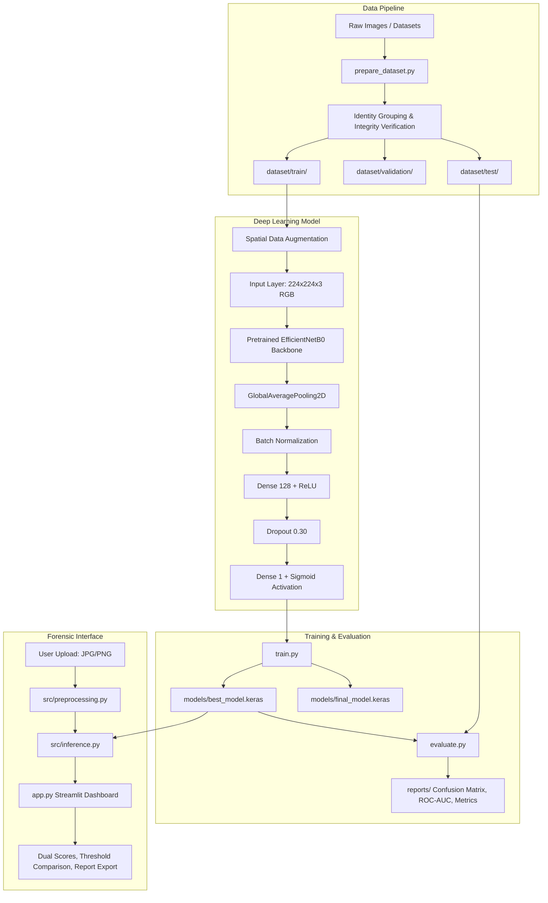

# Deepfake Image Detection System Using Convolutional Neural Networks (CNN)

[](https://www.python.org/)
[](https://tensorflow.org)
[](https://streamlit.io)
[](LICENSE)

An end-to-end, production-grade deep learning solution designed to identify manipulated, synthetic, and face-swapped portrait imagery. The system pairs a high-capacity **EfficientNetB0** convolutional neural network backbone with transfer learning, rigorous data-leakage prevention, comprehensive statistical evaluation, and a modern, responsive **Streamlit** forensic dashboard.

---

## Table of Contents
1. [Project Overview](#project-overview)
2. [System Architecture](#system-architecture)
3. [Key Features](#key-features)
4. [Directory Structure](#directory-structure)
5. [Prerequisites & Environment Setup](#prerequisites--environment-setup)
6. [Dataset Acquisition & Preparation](#dataset-acquisition--preparation)
7. [Model Training](#model-training)
8. [Model Evaluation & Reporting](#model-evaluation--reporting)
9. [Web Application Usage](#web-application-usage)
10. [Hardware Acceleration (CPU, GPU, and Google Colab)](#hardware-acceleration-cpu-gpu-and-google-colab)
11. [Troubleshooting & FAQs](#troubleshooting--faqs)
12. [Forensic Limitations & Ethical Considerations](#forensic-limitations--ethical-considerations)
13. [Citations & Dataset Licensing](#citations--dataset-licensing)

---

## 1. Project Overview

Digital facial manipulation techniques (such as DeepFaceLab, FaceSwap, and generative diffusion models) have created unprecedented challenges for information integrity. This project delivers an automated forensic tool capable of predicting whether an uploaded portrait photograph is **LIKELY REAL** or **LIKELY DEEPFAKE**.

### Core Principles
* **Consistent Class Alignment:** Strictly aligned binary mapping (`fake = 0`, `real = 1`) applied uniformly across dataset generators, model output layers, evaluation metrics, and inference decoders.
* **Dual-Class Scoring:** Clear reporting of both $P(\text{real})$ and $P(\text{fake})$ rather than relying solely on raw binary labels.
* **Leakage-Free Splitting:** Partitioning routines that split datasets by original video ID or identity group, preventing the same subject from appearing in both training and test sets.
* **No Unsubstantiated Claims:** Model outputs are treated as probabilistic algorithmic indicators rather than incontrovertible forensic proof.

---

## 2. System Architecture



---

## 3. Key Features

* **Advanced Transfer Learning:** Utilizes Google's EfficientNetB0 architecture pretrained on ImageNet for compound-scaled feature extraction.
* **Automated Data Validation:** Sanitizes corrupted files, handles exotic color spaces (RGBA, CMYK, Grayscale), and rejects undersized/oversized payloads.
* **Imbalance Compensation:** Automatically calculates balanced class weights via `scikit-learn` to prevent bias toward dominant classes.
* **Two-Stage Training:** Supports both frozen feature-extraction and optional unfreezing of top convolutional blocks for fine-tuning.
* **Configurable Thresholding:** Flexible fake-score decision boundary (default `0.50`), allowing operators to balance false positives vs. false negatives.
* **Full Forensic Reporting:** Export audit logs in formatted plaintext (`.txt`) and structured machine-readable JSON (`.json`).
* **Automated Test Suite:** Built-in `pytest` verification covering preprocessing tensors, format conversions, threshold logic, and missing-model fallbacks.

---

## 4. Directory Structure

```
deepfake-image-detector/
├── app.py                      # Interactive Streamlit forensic web application
├── train.py                    # Transfer learning and fine-tuning training script
├── evaluate.py                 # Independent test set evaluation & metric reporting
├── prepare_dataset.py          # Dataset ingestion, splitting, and benchmark generation
├── requirements.txt            # Pinned Python package dependencies
├── README.md                   # Complete system documentation
├── .gitignore                  # Git ignore rules for datasets, models, and caches
├── dataset/                    # Dataset directory (partitioned by split & class)
│   ├── train/
│   │   ├── real/
│   │   └── fake/
│   ├── validation/
│   │   ├── real/
│   │   └── fake/
│   └── test/
│       ├── real/
│       └── fake/
├── models/                     # Saved binary Keras model weights
│   ├── best_model.keras        # Best checkpoint selected by validation loss
│   └── final_model.keras       # Final model checkpoint at end of training
├── reports/                    # Generated charts, metrics, and evaluation summaries
│   ├── training_curves.png     # Loss, Accuracy, and AUC epoch progression
│   ├── train_metrics.json      # Summary training metrics
│   ├── confusion_matrix.png    # Test set confusion matrix heatmap
│   ├── roc_curve.png           # Test set ROC-AUC curve
│   ├── evaluation_report.txt   # Plaintext classification audit report
│   └── evaluation_metrics.json # Machine-readable test set metrics
├── outputs/                    # Temporary and working outputs
├── src/                        # Modular library source code
│   ├── __init__.py             # Package marker
│   ├── config.py               # Central configuration constants & paths
│   ├── preprocessing.py        # Image validation, resizing, and tf.data pipelines
│   ├── model.py                # EfficientNetB0 architecture & compilation definitions
│   └── inference.py            # DeepfakePredictor inference manager & scoring logic
└── tests/                      # Automated unit test suite
    ├── test_preprocessing.py   # Tests for image validation, scaling, and dimensions
    └── test_inference.py       # Tests for decision thresholds and error handling
```

---

## 5. Prerequisites & Environment Setup

### System Prerequisites
* **Operating System:** Windows 10/11, Ubuntu 20.04+, or macOS
* **Python Version:** Python 3.10, 3.11, 3.12, or 3.13 (64-bit)

### Installation Steps

1. **Clone or Navigate to the Workspace:**
   ```powershell
   cd C:\Users\Dell\.gemini\antigravity-ide\scratch\deepfake-image-detector
   ```

2. **Create and Activate a Virtual Environment:**
   * On Windows (PowerShell):
     ```powershell
     python -m venv .venv
     .venv\Scripts\activate
     ```
   * On Linux / macOS:
     ```bash
     python3 -m venv .venv
     source .venv/bin/activate
     ```

3. **Install Dependencies:**
   ```powershell
   python -m pip install --upgrade pip
   python -m pip install -r requirements.txt
   ```

4. **Verify Environment and Run Unit Tests:**
   ```powershell
   python -m pytest tests/ -v
   ```
   *Expected output: All 10 unit tests passing.*

---

## 6. Dataset Acquisition & Preparation

### Genuine Public Datasets

To train on real-world manipulation datasets, acquire one of the following documented repositories:

#### 1. FaceForensics++ (Official Benchmark)
* **Official Repository:** [https://github.com/ondyari/faceforensics](https://github.com/ondyari/faceforensics)
* **Access Protocol:** FaceForensics++ requires signing an academic agreement via an automated Google Form located on their repository page.
* **Download Command:** Once access is approved, you receive an authorized script (`download_faceforensics.py`):
  ```bash
  python download_faceforensics.py <output_path> -d Deepfakes -c c23 -t videos
  ```
* Extract video frames into `real` and `fake` directories.

#### 2. Kaggle 140k Real and Fake Faces
* **Dataset URL:** [https://www.kaggle.com/datasets/xhlulu/140k-real-and-fake-faces](https://www.kaggle.com/datasets/xhlulu/140k-real-and-fake-faces)
* **Acquisition via Kaggle CLI:**
  ```bash
  kaggle datasets download -d xhlulu/140k-real-and-fake-faces
  unzip 140k-real-and-fake-faces.zip -d raw_dataset/
  ```

#### 3. Celeb-DF (v2)
* **Project Page:** [https://github.com/yuezunli/celeb-deepfakeforensics](https://github.com/yuezunli/celeb-deepfakeforensics)
* Contains 5,639 high-quality deepfake video sequences and original YouTube celebrity interviews.

---

### Preparing Downloaded Data

Once you have extracted your images into a folder containing `real` and `fake` subdirectories, organize and split them with:

```powershell
python prepare_dataset.py --source_dir "C:\path\to\downloaded_raw_dataset" --val_ratio 0.15 --test_ratio 0.15
```

This command will:
1. Validate every image using Pillow, rejecting corrupted or zero-byte files with logged warnings.
2. Group images by identity/video prefix (e.g. `045_321`) to prevent data leakage.
3. Automatically partition them into `dataset/train/`, `dataset/validation/`, and `dataset/test/`.

### Generating Immediate Synthetic Benchmark Data (No Download Needed)

If you wish to test or verify the entire training and inference pipeline immediately without waiting for a large download, run:

```powershell
python prepare_dataset.py --generate_sample_data --sample_count 50
```

---

## 7. Model Training

Train the CNN classifier with transfer learning:

```powershell
python train.py --epochs 10 --batch_size 16 --lr 0.0001
```

### Optional Fine-Tuning Stage
To execute a secondary fine-tuning stage that unfreezes the top 25 convolutional layers of EfficientNetB0 with a reduced learning rate:

```powershell
python train.py --epochs 10 --batch_size 16 --fine_tune --fine_tune_epochs 5 --fine_tune_lr 0.00001
```

### Training Outputs:
* `models/best_model.keras`: Checkpoint saved when validation loss achieves an all-time minimum.
* `models/final_model.keras`: Model weights saved at training completion.
* `reports/training_curves.png`: High-resolution plot displaying loss, accuracy, and AUC progression.
* `reports/train_metrics.json`: Final epoch validation and training metrics.

---

## 8. Model Evaluation & Reporting

Evaluate the trained model strictly against the independent test set (`dataset/test/`):

```powershell
python evaluate.py --threshold 0.50
```

### Generated Reports:
1. **Plaintext Summary (`reports/evaluation_report.txt`):** Includes precision, recall, F1-score, and per-class breakdown.
2. **Confusion Matrix Heatmap (`reports/confusion_matrix.png`):** Visual distribution of True Negatives, False Reals, False Fakes, and True Reals.
3. **ROC Curve (`reports/roc_curve.png`):** Area Under the Curve (AUC) across all classification thresholds.
4. **Structured JSON (`reports/evaluation_metrics.json`):** Machine-readable evaluation metrics.

---

## 9. Web Application Usage

Launch the modern Streamlit forensic interface:

```powershell
streamlit run app.py
```

Open your browser at:
`http://localhost:8501`

### Step-by-Step Workflow:
1. **Overview & Protocol:** Review the forensic analysis mechanics displayed in the hero section.
2. **Threshold Setting:** Adjust the Fake Score decision threshold in the left sidebar if you need stricter or more lenient sensitivity (default is `50%`).
3. **Upload Photograph:** Drag-and-drop or select any `.jpg`, `.jpeg`, or `.png` portrait photograph.
4. **Inspect Preview:** Confirm the image rendered properly and review file metadata (resolution, file size, color mode).
5. **Analyze Image:** Click **`🔍 Analyze Image`** to run the forward inference pass.
6. **Interpret Verdict:**
   * **`LIKELY DEEPFAKE`** (Red Glow): When the synthetic score meets or exceeds the threshold.
   * **`LIKELY REAL`** (Green Glow): When the authenticity score exceeds the threshold.
7. **Export Forensic Audit:** Click **Download Text Report (.txt)** or **Download JSON Report (.json)** to archive the prediction.

---

## 10. Hardware Acceleration (CPU, GPU, and Google Colab)

### Windows Local CPU Execution (Default)
The codebase is fully optimized for CPU execution on Windows. Native TensorFlow 2.11+ binaries on Windows do not natively support direct GPU acceleration without WSL2 or TensorFlow-DirectML. The code automatically leverages multi-threaded CPU instructions (AVX2 / FMA / oneDNN).

### Local GPU Execution (via WSL2 or Linux)
To train on high-end NVIDIA GPUs with CUDA/cuDNN support:
1. Run inside Windows Subsystem for Linux (WSL2 with Ubuntu) or a native Linux environment.
2. Install the CUDA toolkit and cuDNN drivers:
   ```bash
   pip install tensorflow[and-cuda]
   ```
3. Verify GPU visibility:
   ```python
   import tensorflow as tf
   print("GPUs Available:", tf.config.list_physical_devices('GPU'))
   ```

### Google Colab Training (Recommended for Large Datasets)
For training on large datasets like FaceForensics++ (100k+ images):
1. Create a new Google Colab notebook with a free **T4 GPU** runtime.
2. Upload this repository or clone it into Colab:
   ```bash
   !git clone <your-repository-url>
   %cd deepfake-image-detector
   !pip install -r requirements.txt
   ```
3. Run training with GPU acceleration:
   ```bash
   !python train.py --epochs 15 --batch_size 32
   ```
4. Download the generated `models/best_model.keras` back to your local `models/` directory.

---

## 11. Troubleshooting & FAQs

| Issue / Error | Probable Cause | Recommended Solution |
| :--- | :--- | :--- |
| `Model file not found` in `app.py` | Model has not been trained yet. | Run `python prepare_dataset.py --generate_sample_data` followed by `python train.py --epochs 2` to generate baseline weights. |
| `Unsupported image format` | Uploaded image is a TIFF, WebP, or GIF. | The system accepts `.jpg`, `.jpeg`, and `.png`. Convert the image before uploading. |
| `File size exceeds maximum allowed` | Upload exceeds the default 15 MB limit. | Compress the image or adjust `MAX_UPLOAD_SIZE_MB` inside `src/config.py`. |
| `labels argument should be 'inferred'` | Deprecated Keras dataset arguments. | Fixed in our codebase. Ensure `labels="inferred"` and `label_mode="binary"` are used. |
| High RAM usage during training | Batch size is too large for CPU memory. | Reduce the batch size via `--batch_size 8` or `--batch_size 4`. |

---

## 12. Forensic Limitations & Ethical Considerations

> [!WARNING]
> **Important Forensic Notice:**
> Model predictions are probabilistic estimates derived from learned visual representations. They **do not constitute definitive legal or forensic proof** of image authenticity.

### Known Limitations:
1. **Unseen Synthesis Models:** An algorithm trained predominantly on older GAN architectures (e.g., StarGAN, DeepFaceLab) may experience reduced accuracy when evaluating modern latent diffusion models (e.g., Midjourney v6, Stable Diffusion 3, Flux).
2. **Compression Degradation:** Heavy re-compression (e.g., through messaging apps or social networks) removes high-frequency spatial artifacts, potentially resulting in false negatives.
3. **Adversarial Noise:** Deliberate adversarial perturbations or cosmetic filters can alter model activations.
4. **Calibration Notice:** The sigmoid confidence scores represent model output activations and should not be treated as calibrated probabilities without temperature scaling or Platt scaling.

---

## 13. Citations & Dataset Licensing

If you utilize FaceForensics++ or other benchmark datasets in academic research, cite the original publications:

```bibtex
@inproceedings{roessler2019faceforensicspp,
  title={FaceForensics++: Learning to Detect Manipulated Facial Images},
  author={R{\"o}ssler, Andreas and Cozzolino, Davide and Verdoliva, Luisa and Riess, Christian and Thies, Justus and Nie{\ss}ner, Matthias},
  booktitle={International Conference on Computer Vision (ICCV)},
  year={2019}
}

@inproceedings{tan2019efficientnet,
  title={EfficientNet: Rethinking Model Scaling for Convolutional Neural Networks},
  author={Tan, Mingxing and Le, Quoc},
  booktitle={International Conference on Machine Learning (ICML)},
  pages={6105--6114},
  year={2019}
}
```

### Dataset Terms of Use
* **FaceForensics++:** Available strictly for academic, non-commercial research pursuant to the [TUM / University of Erlangen agreement](https://github.com/ondyari/faceforensics).
* **Codebase License:** MIT License. Free for research, educational, and commercial evaluation.
